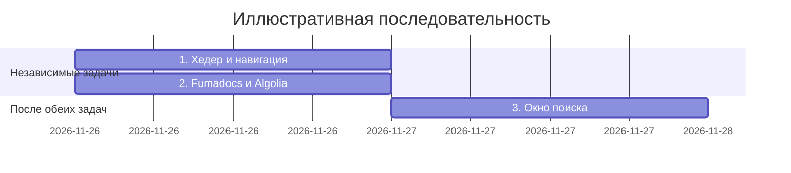

# План работ · Единый хедер

Сроки на диаграмме условные и показывают только порядок и возможность параллельной работы; это не оценка поставки.

- [№ 1 · Единый хедер: вёрстка и навигация](1.md) — без зависимостей.
- [№ 2 · Источники заданий и гайдов в Fumadocs, синхронизация Algolia](2.md) — без зависимостей.
- [№ 3 · Окно поиска по заданиям и гайдам](3.md) — после № 1 и № 2.
